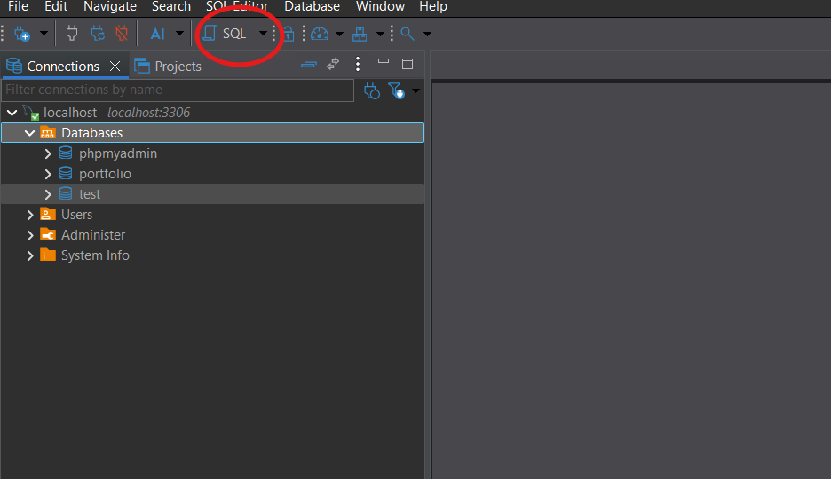
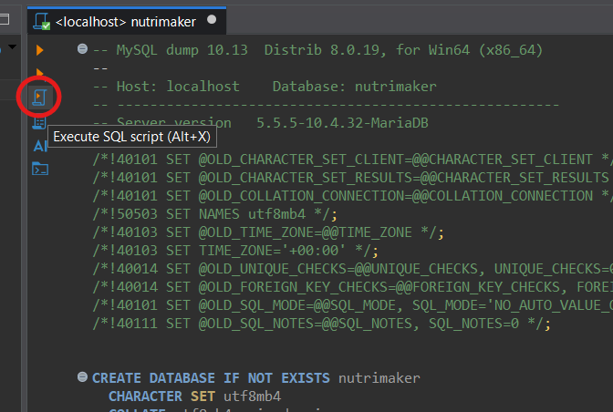
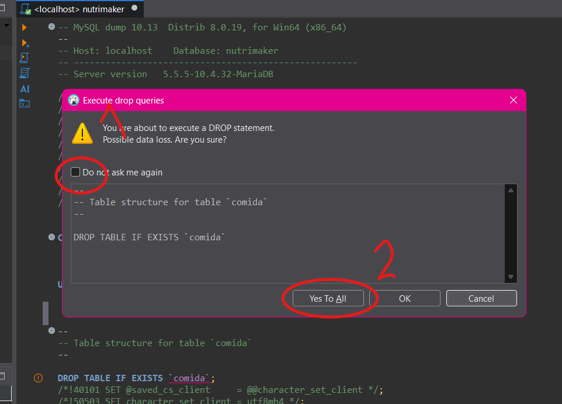

# Instalación de la base de datos NutriMaker en DBeaver

Esta guía explica cómo importar y ejecutar el archivo `nutrimaker.sql` desde **DBeaver** para crear la base de datos `nutrimaker` y cargar sus tablas y registros.

## Requisitos

- Tener instalado **DBeaver**.
- Tener un servidor **MySQL o MariaDB** encendido y una conexión configurada en DBeaver (en las capturas se utiliza `localhost:3306`).
- Contar con permisos para crear bases de datos y tablas.
- Tener disponible el archivo `nutrimaker.sql`.

## Estructura de archivos

Organiza el README, el script y las capturas de la siguiente manera:

```text
proyecto/
├── README.md
├── nutrimaker.sql
└── img/
    ├── 1.png
    ├── 2.png
    └── 3.png
```

> Las imágenes se muestran mediante rutas relativas, por lo que la carpeta `img` debe permanecer junto al README.

## Paso 1. Abrir el script SQL

1. Abre **DBeaver** y conecta tu servidor MySQL/MariaDB.
2. Abre el archivo `nutrimaker.sql` en el editor SQL de DBeaver. Puedes hacerlo desde **SQL Editor → Open SQL Script** o abriendo el archivo desde DBeaver.
3. Comprueba que el editor está asociado con la conexión correcta (`localhost` en el ejemplo).



El script incluye instrucciones para crear la base de datos `nutrimaker` si todavía no existe y seleccionarla para las operaciones posteriores:

```sql
CREATE DATABASE IF NOT EXISTS nutrimaker
  CHARACTER SET utf8mb4
  COLLATE utf8mb4_unicode_ci;

USE `nutrimaker`;
```

## Paso 2. Ejecutar el script completo

1. Con el archivo abierto, haz clic en el botón **Execute SQL Script** señalado en la primera captura o usa **Alt + X**.
2. Ejecuta **todo el script**, no solo una sentencia individual, para que se creen las tablas y se inserten los datos incluidos.
3. Si aparece una ventana de confirmación para ejecutar instrucciones `DROP TABLE IF EXISTS`, revisa la advertencia.
4. Si estás instalando la base de datos en un entorno nuevo y no necesitas conservar tablas anteriores, haz clic en **Yes To All** para aceptar todas las operaciones de eliminación indicadas por el script.



> **Advertencia importante:** `DROP TABLE IF EXISTS` elimina las tablas existentes y sus datos antes de recrearlas. **No selecciones “Yes To All” si necesitas conservar información de una instalación anterior.** Haz primero una copia de seguridad y revisa el contenido del script. Esta opción es adecuada para una instalación limpia o para restaurar deliberadamente el contenido del respaldo.

## Paso 3. Verificar la base de datos creada

1. Cuando termine la ejecución, vuelve al panel **Database Navigator / Connections**.
2. Haz clic derecho sobre la conexión y selecciona **Refresh** (o pulsa **F5**) para actualizar el listado.
3. Despliega **Databases** y busca **`nutrimaker`**.
4. Expande la base de datos para consultar sus tablas.



> La tercera captura muestra el panel de conexiones y el botón **SQL** para abrir un editor. En esa imagen todavía no aparece `nutrimaker` en la lista; por eso es necesario actualizar el navegador y verificar que la ejecución haya finalizado correctamente.

## Comprobación opcional mediante SQL

Abre un editor SQL conectado al mismo servidor y ejecuta:

```sql
SHOW DATABASES LIKE 'nutrimaker';
USE nutrimaker;
SHOW TABLES;
SELECT COUNT(*) AS total_dietas FROM dieta;
```

Si la importación se realizó correctamente, podrás consultar las tablas de NutriMaker, como `comida`, `dieta`, `ingrediente`, `ingrediente_comida`, `paciente` y `usuario`, además de los registros de prueba incluidos en el archivo.

## Solución de problemas

- **No aparece `nutrimaker`:** actualiza el navegador con **F5**, verifica la conexión y revisa si DBeaver mostró errores durante la ejecución.
- **Error de permisos:** comprueba que el usuario de MySQL/MariaDB tenga permisos para crear bases de datos, tablas e insertar datos.
- **Aparece la advertencia `DROP`:** es normal cuando el script contiene sentencias `DROP TABLE IF EXISTS`; acepta solo si comprendes que se pueden borrar datos anteriores.
- **El script se ejecuta parcialmente:** asegúrate de usar **Execute SQL Script (Alt + X)** y no la opción de ejecutar únicamente la sentencia bajo el cursor.

---

**Resultado esperado:** base de datos `nutrimaker` creada en el servidor MySQL/MariaDB y poblada con la estructura y los datos definidos en `nutrimaker.sql`.
